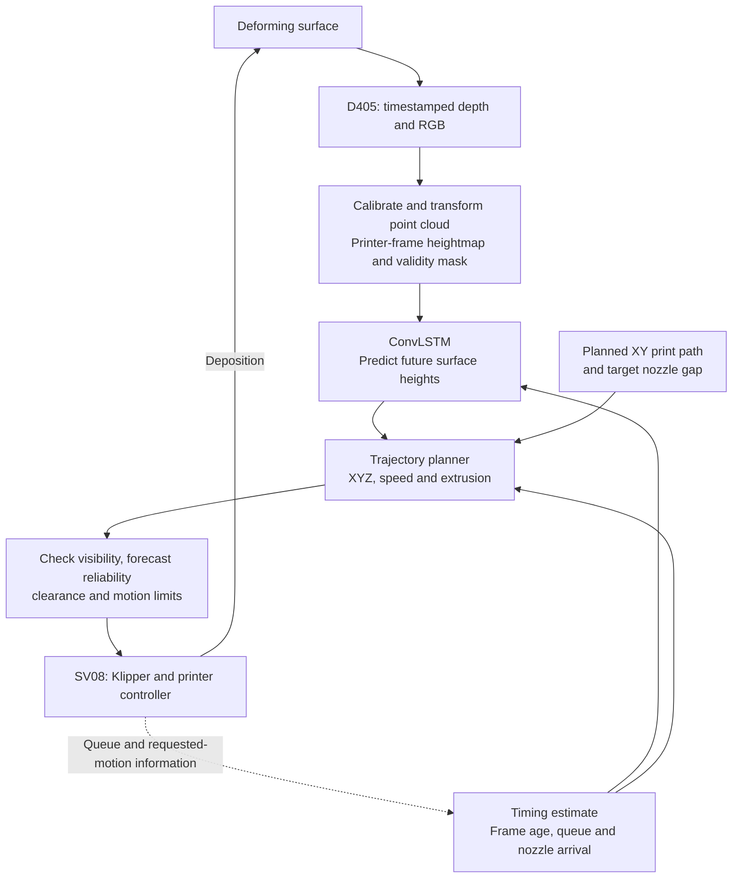

# Predictive printing on a dynamically deforming surface

Project outline — 20 September 2026

**Objective:** Use a RealSense D405 to observe a moving surface, predict its future height with ConvLSTM, and adapt a Sovol SV08 trajectory to maintain the intended nozzle-to-surface gap during deposition. Demonstrate improvement in printed bead quality against matched nonpredictive baselines.

**Confirmed first-prototype scope:** Mainly up-and-down deformation. Begin with a small printing region, gentle slopes, negligible lateral material motion, a fixed camera, and single-layer lines or simple patterns. Assume one visible surface height for each printer XY location. This is a proposed architecture; its sensing accuracy, timing, and motion envelope still need experimental verification.

## 1. Research question and success criteria

Can predicting surface height at the nozzle's actual arrival time reduce gap error and improve deposition quality compared with using the latest measured surface?

The causal chain to establish is:

**Accurate observations → useful future-height predictions → feasible, correctly timed nozzle motion → more consistent deposition.**

Success requires improvement at all relevant levels:

- **Prediction:** Lower height error along the upcoming toolpath at the required forecast horizons.
- **Control:** Lower nozzle-gap error without introducing discontinuities, excessive delay, or motion-limit violations.
- **Printing:** More uniform bead width/height, better continuity and placement, and fewer failed prints under matched conditions.

Set numerical acceptance limits from the selected material, nozzle, nominal gap, and permitted bead variation. A lower whole-image depth error alone does not establish better printing.

## 2. Hardware and division of work

| Component | Proposed role | Initial decision |
|---|---|---|
| Sovol SV08 | Coordinated XYZ motion, extrusion, heaters, and low-level step scheduling | Retain the existing Klipper host and printer controller; characterize the actual installed configuration. |
| RealSense D405 | Timestamped depth acquisition; RGB for inspection, masking, or tracking if useful | Rigidly mount relative to the stationary printer frame, with a clear view of a small printing region. |
| Workstation with GPU | Dataset preparation, model training, initial inference, planning, and logging | Recommended development host; benchmark actual inference and end-to-end delay. |
| Raspberry Pi, optional | Camera acquisition, logging, or communications gateway | Add only when it serves a measured deployment need. Pi-only inference is a later benchmark, not an initial assumption. |
| Controlled motion fixture | Repeatable vertical motion and then local surface deformation | Begin with known motion; use encoder or other independent displacement measurements where possible. |

The SV08 already includes a Klipper host; the manufacturer lists an onboard H616 computer, and its official software includes Moonraker. A Pi is therefore not required simply to send printer commands. Recommended first arrangement: **D405 → workstation → wired network → existing SV08 host → printer controller**. [SV08 specifications](https://www.sovol3d.com/products/sovol-sv08-3d-printer), [official Moonraker configuration](https://raw.githubusercontent.com/Sovol3d/SV08/main/home/sovol/printer_data/config/moonraker.conf).

The D405's published ideal working range is 7–50 cm. Select mounting distance, illumination, and image settings by measurement on the actual substrate. Its published close-range accuracy claims do not guarantee the gap tolerance of this experiment. Start with a local region instead of requiring coverage of the entire bed. [D405 specifications](https://store.realsenseai.com/buy-realsense-depth-camera-d405.html).

## 3. System pipeline



Record observations, model outputs, planned motion, printer state, and experimental reference measurements throughout. Offline training uses recorded sessions; the online loop uses a fixed trained model during each controlled evaluation.

## 4. Geometry, sensing, and calibration

1. Define printer XYZ, camera coordinates, nozzle-tip offset, and the fixed XY region to observe.
2. Verify camera intrinsics and depth scale. Estimate the camera-to-printer rigid transform using a calibration target or known geometry, then check it at multiple positions and heights.
3. Convert depth pixels to 3D points, transform them into printer coordinates, and rasterize onto a regular XY grid to obtain surface height **H(x, y, t)**.
4. Preserve validity masks and acquisition timestamps. Mask the nozzle, background, and unreliable regions; distinguish deposited material from substrate motion when necessary.
5. Use causal filtering and measure its delay. Avoid treating hole-filled or occluded pixels as reliable observations.

**Camera depth is not printer Z.** Conversion into the printer frame is necessary before heights can control the nozzle. ConvLSTM operates on regular spatial grids, which motivates the heightmap representation instead of feeding an unordered point cloud directly. [RealSense projection and coordinate transforms](https://dev.realsenseai.com/docs/projection-in-realsense-sdk-2-0/).

For the first single-layer experiment, define H as the receiving substrate surface. For later layers, explicitly define whether the model predicts the current printable top surface or the substrate plus a separate deposited-height model. Do not add printed thickness twice.

## 5. ConvLSTM prediction

The method is usually written **ConvLSTM**, meaning convolutional long short-term memory. Its original formulation uses convolutional recurrent transitions to forecast spatially structured sequences. Applying it to printer-frame surface heights is this project's adaptation. [Shi et al., NeurIPS 2015](https://papers.nips.cc/paper/2015/hash/07563a3fe3bbe7e3ba84431ad9d055af-Abstract.html).

**Proposed model:** A compact spatial encoder → ConvLSTM recurrent layers → decoder that produces several future heightmaps.

- **Inputs:** A recent sequence of heightmaps and validity masks. Handle irregular timing explicitly or resample causally to a known cadence.
- **Outputs:** Heights, or height changes relative to the latest observation, at several future times. Select or interpolate within the validated horizon for each planned trajectory point.
- **History length:** Choose from measured deformation timescales; there is no universal frame count.
- **Prediction horizon:** Cover the actual observation-to-deposition delay and its variation, plus the future segment being planned.
- **Training objective:** Start with masked MAE or Huber loss in physical height units. Consider gradient penalties only if they improve shape fidelity without suppressing genuine deformation.
- **Reliability:** Use held-out error distributions and checks for invalid inputs. Any learned uncertainty output needs calibration; ConvLSTM does not inherently provide reliable confidence.

Training data should include static surfaces, repeatable sinusoidal motion, varying amplitudes and frequencies, combined motions, local deformation, and actual printing conditions. Include occlusion and changing bead appearance. Record complete sessions and split trials/sessions before constructing overlapping training windows; adjacent windows must not leak across train and test sets.

## 6. Prediction-to-motion conversion

For a planned XY point k, define:

\[
\tau_k=t_{\mathrm{arrival},k}-t_{\mathrm{observation}},\qquad
z_k=\widehat H(x_k,y_k,t_{\mathrm{arrival},k})+g_k.
\]

Here g is the desired vertical nozzle-to-surface gap. For the confirmed prototype, retain the planned XY pattern and compensate primarily in Z. Gentle slopes keep the fixed vertical nozzle and vertical-gap approximation practical; steep surfaces and nozzle reorientation are outside this first scope.

The forecast must include acquisition/frame age, filtering, inference, communication, committed printer motion, and time until the nozzle reaches the point. Map clocks between devices and measure latency and jitter. Forecasting only one camera frame ahead is insufficient unless it happens to match the measured execution timing.

The planner should:

- Generate short, smooth, coordinated XYZ and extrusion segments.
- Replan the uncommitted future trajectory while preserving already queued motion.
- Keep enough buffered motion for continuous execution, but bound the buffer so its duration fits the useful forecast horizon.
- Recalculate speed and extrusion consistently with the corrected path and deposition conditions. Extrusion should follow bead volume per unit path relative to the substrate; vertical translation of the whole surface does not by itself require additional material.
- Account for existing bed-mesh compensation and coordinate offsets so that height corrections are applied only once.
- Reject stale observations, unsupported forecast horizons, invalid regions, and infeasible trajectories.
- Use a prevalidated stop/extrusion-stop and clearance response when tracking cannot continue; a stationary nozzle is not automatically safe if the surface rises.

Klipper uses look-ahead and queues motion; an API acknowledgement does not establish that the nozzle has reached a coordinate. Its reported requested position is also not independent encoder feedback. Start by instrumenting the available interface; use a dedicated host-side planning integration if ordinary short G-code batches cannot provide adequate timing and queue observability. Avoid mixing correction commands into an unrelated, deeply queued print file. [Klipper motion planning](https://www.klipper3d.org/Kinematics.html), [Klipper API](https://www.klipper3d.org/API_Server.html), [Klipper status reference](https://www.klipper3d.org/Status_Reference.html).

## 7. Establish the feasible motion envelope first

Sensing, timing, and Z tracking can each limit the project even when the model predicts well.

For uniform vertical sinusoidal motion of amplitude A and frequency f:

\[
v_{z,\mathrm{peak}}=2\pi fA,\qquad
a_{z,\mathrm{peak}}=(2\pi f)^2A.
\]

Along a spatially varying surface, the required vertical speed also includes the height change caused by travelling across slopes:

\[
\dot z=\frac{\partial H}{\partial t}+\nabla H\cdot\mathbf v_{xy}
\]

for a constant gap. These are preliminary kinematic checks, not guarantees of tracking performance. Timing uncertainty contributes approximately **|vertical speed| × timing error** to the height mismatch.

Sovol's published configuration sets Z limits of 20 mm/s and 500 mm/s². Those are configuration values, not measured closed-loop tracking capabilities; inspect the actual printer and establish margins through dry runs. [Official SV08 printer configuration](https://raw.githubusercontent.com/Sovol3d/SV08/main/home/sovol/printer_data/config/printer.cfg).

Build an error budget around calibration, observation/prediction error, timing uncertainty, and motion following. Measure depth bias and repeatability using reference geometry and known displacements. If these errors already exceed the permitted nozzle-gap variation, revise the optics, mounting, gap, material, or sensing approach before expanding model training.

## 8. Experiments and evidence

| Comparison | Purpose |
|---|---|
| Static surface and static path | Establish achievable print quality and sensing noise. |
| Moving surface with an initially measured, fixed path | Establish the uncompensated dynamic error. |
| Moving surface with latest-height/reactive compensation | Measure what sensing alone achieves. |
| Moving surface with constant-velocity prediction | Test whether a simple forecast is sufficient. |
| Moving surface with a periodic predictor, for periodic tests | Provide a strong baseline for repeatable motion. |
| Moving surface with ConvLSTM prediction | Test the added value of learned spatial and temporal forecasting. |

Use matched trajectories, materials, nominal gaps, temperatures, and motion profiles; record any speed reductions imposed by the controller. Repeat trials and vary their order. Hold out complete sessions and motion conditions, including frequencies or patterns not used for training.

Report three groups of metrics:

1. **Prediction:** Height MAE and 95th-percentile absolute error in millimeters, by horizon and specifically at upcoming toolpath locations; valid coverage and inference time.
2. **Control:** Gap error during dry runs, execution-time error, delay distribution, motion-limit events, and tracking failure frequency.
3. **Print quality:** Bead width/height variation, continuity, placement error, adhesion if relevant, and failed-print rate, reported across repeated trials.

Future D405 frames provide convenient training targets but remain noisy measurements. Use independent reference displacement for controlled motion and an appropriate independent measurement of bead geometry to substantiate accuracy and quality claims. Global fixture displacement alone is not ground truth for every point on a locally deforming membrane.

## 9. Work packages and stage gates

| Stage | Deliverable | Condition for proceeding |
|---|---|---|
| 1. Define demonstrator | Material/nozzle/gap choice, local printing region, controlled motion fixture, and quality tolerances | A measurable target and repeatable motion are specified. |
| 2. Calibrate and characterize | Camera-to-printer transform, depth error measurements, actual Z limits, and latency/jitter report | Sensing and motion can plausibly meet the required gap tolerance. |
| 3. Build synchronized dataset | Recorded sessions with timestamps, masks, motion references, and predetermined splits | Reliable geometry and timing survive replay without data leakage. |
| 4. Compare offline predictors | Persistence, velocity/periodic baselines, and ConvLSTM results by forecast horizon | ConvLSTM adds useful accuracy at the measured execution horizon, or a simpler model is selected. |
| 5. Validate motion without extrusion | Static contour following, then known moving-surface tracking | Gap and timing errors meet tolerance; failure responses work in the validated envelope. |
| 6. Demonstrate deposition | Single lines, simple patterns, then local deformation trials | Predictive operation improves specified quality measures in matched repeated tests. |
| 7. Refine deployment | Optional Pi integration, more efficient model, larger patterns or additional layers | Performance gains survive the deployment hardware and added complexity. |

## 10. Suggested software organization

```text
Dynamic_Surface_Printer/
  PROJECT_OUTLINE.md
  configs/          Camera, calibration, model and experiment settings
  acquisition/      Timestamped D405 capture and session recording
  geometry/         Coordinate transforms, masking and heightmap generation
  datasets/         Dataset manifests and whole-session split definitions
  prediction/       Baselines, ConvLSTM training and inference
  planning/         Arrival-time estimation and constrained trajectory generation
  printer/          SV08 interface, queue monitoring and fault handling
  experiments/      Repeatable protocols and run metadata
  evaluation/       Prediction, tracking and deposition measurements
```

Keep large raw recordings outside source control and reference them through dataset manifests. Save calibration versions, model versions, configuration, timestamps, and run identifiers with every experiment.

The first concrete milestone is a calibrated heightmap and a timestamped dry-run demonstration on a repeatably moving surface. Its measurements determine how far ahead the model must predict and whether the printer can execute the needed corrections.
