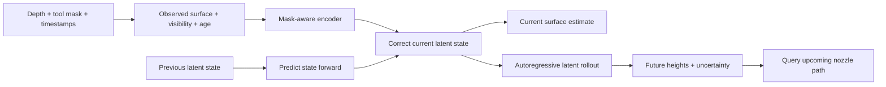

# Occlusion-aware forecasting for dynamic surface printing

Active research plan — 31 October 2026

This plan supersedes the earlier proposal to make a simple whole-surface ConvLSTM predictor the central method. The new problem is **causal estimation and autoregressive forecasting of a partially observed deforming surface**, with accuracy assessed at the nozzle's future arrival locations. Existing acquisition, calibration, recording, simulation, and controller infrastructure remains useful. An experimental offline ConvLSTM + U-Net prototype implements part of this plan; see [its guide](OCCLUSION_CONVLSTM_UNET.md). The full experiments and physical validation remain proposals.

## 1. Research objective and first decision

Given recent depth measurements with moving toolhead occlusions, estimate the current hidden surface and predict its future height at the times and positions needed by the printer. Maintain the distinction between actual measurements and inferred geometry throughout.

The recommended first system is a **mask-aware spatial encoder, compact latent dynamics model, measurement-correction step, and metric-height decoder**. Start with a small learned recurrent state, such as a latent GRU. Benchmark it against simple geometric/state-estimation methods and a mask-adapted SimVP model. Consider RKN, PhyCell, or SparQT after the benchmark is working.

The initial scientific question is whether temporal memory and explicit visibility improve hidden-region and future toolpath accuracy beyond spatial interpolation and simple motion models. A lower average image error is insufficient if the forecast fails precisely where the nozzle hides the surface.

Keep the initial geometry assumptions: predominantly vertical deformation, modest slopes, negligible lateral material motion, a fixed camera, and a small region representable as one height per printer XY location. Folds, overhangs, or large lateral motion require revisiting the heightmap representation.

## 2. Correct the ground-truth acquisition strategy

Moving the nozzle away later does **not** reveal the ground truth of an earlier hidden frame. The surface can have changed shape, phase, or velocity. Repeating the same motion command is also not proof that a flexible surface repeated its trajectory.

Use three complementary datasets:

| Dataset | Acquisition | Role and available truth |
| --- | --- | --- |
| Clean motion | Record unobstructed sequences with the nozzle outside the view | Preserve original frames as reference targets; apply artificial occlusion only to copies used as model inputs. This gives exact temporal pairing wherever the original sensor measurement is valid. |
| Real occlusion | Record representative nozzle/toolhead poses and motion over the moving surface | Measure silhouettes, dwell times, boundary artifacts, and actual observation quality. Hidden regions have no direct labels without an independent reference. |
| Real occlusion plus reference | Add a synchronized, calibrated view or independent displacement measurement | Validate actual hidden-region estimates wherever the reference observes or measures the relevant geometry. Quantify reference noise and synchronization error. |

The first dataset is the main supervised training source. The second informs realistic augmentation and checks the observation pipeline. The third supports final claims about performance under real nozzle occlusion.

A second view is not automatically complete ground truth: it may have its own occlusions, and its geometry must be compared in a common coordinate frame. A displacement probe validates its measured location, not an entire flexible surface. Repeatable motion can substitute for simultaneous measurement only after independently quantifying repeatability and phase alignment; call it an approximate reference.

Begin with non-contact motion. If deposition, contact, heat, or airflow changes surface dynamics, unobstructed no-print sequences do not cover that intervention. Add interaction data and known action inputs later. Define whether the target is the receiving substrate or the current printable top surface, so deposited thickness is not counted twice.

## 3. Represent what the camera actually knows

Predict metric depth/height, with RGB optional for segmentation or auxiliary features. RGB completion alone does not supply validated millimetre geometry.

For each frame retain:

| Field | Meaning |
| --- | --- |
| `height_observed_mm` | Surface measurements after excluding the toolhead; invalid entries remain invalid on disk. |
| `sensor_valid` | The depth sensor returned a usable measurement; this alone does not identify surface versus nozzle. |
| `occluder_mask` | Toolhead/nozzle region, with camera-image and grid-space representations distinguished. |
| `surface_observed` | A trustworthy measurement of the target surface at this grid cell. |
| `observation_age_ms` | Time since the last trustworthy surface measurement; include a never-observed flag. |
| `height_target_mm`, `target_valid` | Original clean/reference geometry and its independent label validity, for supervised data only. |
| Timing and metadata | Camera and host times, clock mapping, geometry/calibration ID, nozzle pose and its source/time, motion conditions, augmentation seed. |

Preserve raw depth and intrinsics. Add synchronized RGB only if it materially helps masking; the current capture code enables depth only. Commanded nozzle position and measured/executed position must have separate provenance.

**A nozzle can return valid foreground depth.** Exclude those points before heightmap aggregation, otherwise the projector may average the tool into the supposed surface. Ordinary zero-depth filtering is not sufficient. Use calibrated projected tool geometry, image segmentation, or a combination, with an uncertain boundary band. Compare an oracle mask against the automatically estimated mask so segmentation and forecasting errors are distinguishable.

For synthetic training, let V be original clean validity and O be artificial occlusion. Then the observation mask is M = V AND NOT O. Feed a finite, normalized placeholder at missing cells together with M; never interpret the placeholder as a physical zero height. The loss uses independent clean/reference target validity G, not M. Natural holes in a clean sequence are not new ground-truth values.

Camera-image masks and printer-XY masks are different. First use grid-space masks for a quick controlled benchmark. Then mask raw depth rays and reproject them through the normal geometry pipeline to test realistic camera occlusion. Count both image occlusion and lost coverage in the printing region.

The current D405 example requests 640 × 480 depth at 30 FPS and produces a 75 × 100 grid with 2 mm cells. Its transform is identity, so its values are **camera Z, not printer Z**. A measured transform is required for printing interpretation. Grid spacing also limits spatial detail; interpolation cannot manufacture missing physical resolution.

## 4. Generate realistic occlusion sequences

The number of blocked pixels is a useful summary, but the learning problem depends on **where, how long, and in what pattern** they are blocked.

Use a progression of augmentations:

1. Stationary contiguous rectangles, ellipses, and tool-like silhouettes.
2. Smoothly moving masks with stops, reversals, entry/exit, and long dwell periods.
3. Recorded real toolhead silhouettes or projected approximate geometry across camera/nozzle poses.
4. Boundary corruption, invalid-depth bands, measurement noise, dropped frames, and imperfect masks.
5. Local blackout of the future nozzle neighborhood, including locations never seen in the available history.

Randomize trajectories and dimensions across examples while keeping each sequence temporally coherent. Independent random holes in every frame can accidentally make the entire surface observable over a short history and create an easier problem than the printer presents.

An initial stress sweep can use 0%, 10%, 25%, and 50% occluded ROI area, plus near-total local occlusion. These are proposed test bins, not measurements of this printer. Replace or supplement them with rig-measured distributions. Sweep hidden duration in seconds and relative to the surface motion period, not only frame count.

Split original sessions before making windows, masks, or augmented copies. Hold out mask trajectories and silhouette variants as well as surface motions. Save deterministic validation/test masks. More augmented samples do not equal more independent physical trials.

For simulated data, independently randomize mask motion and surface motion to avoid a shortcut where nozzle position predicts wave phase. Add physically coupled cases separately if the real tool influences the surface.

## 5. Proposed causal model

Write the model as:

\[
z_t^- = F_\theta(z_{t-1}, \Delta t, u_{t-1}),\qquad
e_t = E_\theta(y_t, M_t, A_t)
\]

\[
z_t = U_\theta(z_t^-, e_t, M_t),\qquad
\hat h_t = D_\theta(z_t)
\]

Here y is observed normalized height, M is visibility, A is observation age, z is a compact learned surface state, and u contains any relevant inputs known at the time of prediction. F advances the state; U corrects it using new measurements. If an entire frame contains no useful observations, skip correction and propagate the state. Spatially hidden areas may still be informed by visible neighboring motion.

To forecast from time t, copy the corrected state and apply F repeatedly without future measurement updates. Decode each required future step. This is autoregression in latent space; it does not require treating generated depth images as observations. Keep this rollout separate from the live state so hypothetical future predictions cannot overwrite the current filtered state.

At the next real frame, correct the live state using newly visible data and forecast again. Evaluate both operating modes separately: **open-loop rollout** with no later observations, and **online filtering** with successive real partial observations. Reporting the second as if it were the first would exaggerate forecasting performance.

For a compact first prototype, use a 64 × 64 crop, a small CNN encoder, a low-resolution spatial recurrent state or compact GRU bottleneck, and a decoder with a one-channel metric-height head. Begin with ordinary convolutions plus mask/age channels; compare partial convolutions as an ablation. A dense hidden-state map may be useful internally even though the operational target is a local path neighborhood.

Proposed starting settings are 8–16 history frames and 1–8 rollout steps on genuine 30 FPS data, adjusted to measured dynamics and latency. For the existing 5 FPS cloth data, use appropriate longer physical intervals; do not relabel those frames as 30 FPS. Prefer keeping accurate timestamps and explicitly modelling or restricting cadence.

The relevant lead time is nozzle arrival time minus the latest observation's acquisition time. Include frame age, processing, communication, queuing, and segment timing without double-counting components. Forecast at validated horizons and reject unsupported extrapolation. Known planned nozzle motion may define queries and anticipated occlusion; future measured poses or surface observations cannot be used as inputs.

## 6. Available models and selection

The links below were checked on 31 October 2026. Public source availability does not mean installation or performance has been validated in this project. None is a pretrained D405/nozzle surface predictor.

| Candidate | Fit to this problem | Adaptation and priority |
| --- | --- | --- |
| **Mask-aware CNN + latent GRU/filter** | Directly implements observation correction and temporal state propagation. NVIDIA supplies a reusable [partial-convolution layer](https://github.com/NVIDIA/partialconv). | **Recommended first custom model.** The complete architecture is our proposed integration. Partial convolution alone performs spatial missing-data processing, not future prediction. |
| **SimVP / SimVPv2 through OpenSTL** | A practical convolutional forecasting comparison with [available code and experiment infrastructure](https://github.com/chengtan9907/OpenSTL). | **First external benchmark.** Add mask/age inputs and metric-height targets. Standard SimVP predicts a block directly; recursive use is an adaptation. Separate input channels from output channels and never generate a fake observation-valid mask. |
| **Recurrent Kalman Network (RKN)** | Explicit uncertainty and learned predict/update inference; [paper](https://proceedings.mlr.press/v97/becker19a.html), [author-group PyTorch code](https://github.com/ALRhub/rkn_share). | Strong second-stage filtering option. Needs a surface encoder/decoder and visibility-dependent observation uncertainty; an observation-valid flag is not automatically a per-pixel mask. Older environment needs reproduction. |
| **PhyDNet / PhyCell** | Learned dynamics plus observation correction with a physics-oriented branch; [official implementation](https://github.com/vincent-leguen/PhyDNet). | Useful for structured smooth motion. Published missing-frame handling does not establish performance on moving spatial holes. Full PhyDNet retains a ConvLSTM residual branch; use it as a structured alternative, not a rename of the old plan. |
| **SparQT, AAAI 2026** | Reconstructs latent representations from sparse observations, then forecasts latent tokens autoregressively; [paper](https://ojs.aaai.org/index.php/AAAI/article/view/39897), [released code](https://github.com/wznwznwzn123/SparQT). | Closely related research direction. Sparse point observations differ from persistent contiguous nozzle occlusion. Multiple training stages and codebook reconstruction need reproduction; check the metric precision floor before forecasting. No clear license was visible in the inspected root listing. |
| **Earthformer** | Space-time attention for field forecasting; [official implementation](https://github.com/amazon-science/earth-forecasting-transformer). | Later comparison if small models miss long-range coupling. Observation masking, surface training, and streaming rollout require adaptation. Weather weights do not establish useful transfer to depth. |

OpenSTL's current SimVP implementation ties input/output channel counts and recursively feeds predicted blocks in its long-horizon wrapper. The mask-aware version therefore requires model/wrapper edits, not just a configuration change. See its [model](https://github.com/chengtan9907/OpenSTL/blob/OpenSTL-Lightning/openstl/models/simvp_model.py) and [forecast wrapper](https://github.com/chengtan9907/OpenSTL/blob/OpenSTL-Lightning/openstl/methods/simvp.py).

Two distinctions prevent choosing the wrong tool:

- [ProPainter](https://github.com/sczhou/ProPainter) is video inpainting. Its [inference implementation](https://github.com/sczhou/ProPainter/blob/main/inference_propainter.py) uses bidirectional flow and frames surrounding the frame being restored. Full-video results would leak future information in an online forecast benchmark. It is not a future-height predictor.
- [LANO](https://arxiv.org/abs/2601.15547) is relevant to learning under partial observations, but its boundary-first autoregression concerns spatial reconstruction. Do not equate that with the temporal rollout required here. The [public repository](https://github.com/Kingyum-Hou/LANO) had an empty README when inspected, so it is a research reference rather than the first reproduction target.

PredRNN can remain an optional recurrent baseline through OpenSTL. Large RGB video generators and full reinforcement-learning systems add substantial machinery before solving metric supervision or observation semantics; they are not priorities for this experiment.

## 7. Training procedure and losses

1. **Establish clean dynamics.** Train and test basic motion forecasting on synthetic fields and clean recordings. Verify that the data contains predictive signal beyond persistence.
2. **Learn hidden-state estimation.** Apply masks to historical inputs and supervise present-state reconstruction with the preserved clean target. This checks whether spatial context and memory recover hidden geometry.
3. **Train multi-step rollout.** Jointly optimize present reconstruction and future trajectories, increasing rollout length. Include free-running segments, not only single-step predictions with true previous frames.
4. **Match deployment observations.** Train sequences with realistic occlusion, dwell periods, dropped frames, and reappearance. Correct state only with observations available at that instant.
5. **Adapt to the actual camera.** Fine-tune on clean D405 data with rig-derived synthetic masks, then use real-occlusion data where valid supervision or a reference exists.
6. **Calibrate reliability.** Fit prediction-interval calibration on held-out validation sessions, stratified where feasible by lead time, visibility and duration hidden. Evaluate once on reserved tests.

A suitable initial objective is a weighted sum of current reconstruction, multi-horizon Huber/MAE, hidden-region error, and future path-neighborhood error. Normalize each regional loss by its own valid target count so a small important region is not overwhelmed by the rest of the image. Hidden-region forecasting can be stratified by visibility at the forecast origin and by prior observation age.

Use only valid reference labels at each target time. Optional spatial-gradient and temporal-increment losses should be checked against oversmoothing real deformation. Add a probabilistic head or small ensemble once deterministic forecasts work; train its proper likelihood/quantile objective and assess calibration. A learned variance is not automatically trustworthy.

Training normalization and any learned surface basis use training data only. Future labels may supply loss targets, but cannot enter the inference computation. If teacher forcing is used initially, remove it from evaluation and progressively train on the model's own rollouts. No bidirectional smoothing or centered temporal filtering is permitted in causal inputs.

## 8. Evaluation that tests occlusion rather than avoiding it

The current main evaluator compares methods only on cells supported throughout their fitted history. That is reasonable for the previous visible-data comparison, but excludes the hard hidden locations. Replace the main benchmark support with a predefined clean-target-valid evaluation region, and report coverage/failures explicitly. Do not silently remove cells where a baseline or model fails.

Build this baseline ladder:

| Baseline | Purpose |
| --- | --- |
| Last valid height with age tracking | Minimum temporal memory; specify fallback and coverage for never-observed cells. |
| Local plane/interpolation plus velocity | Tests whether simple geometry and motion already explain the surface. Fit only available observations. |
| Low-dimensional surface modes + Kalman filter | Strong observer for correlated/periodic deformation. Fit modes/dynamics on training data; update using only currently visible locations. |
| Single-frame masked completion + forecast | Separates spatial completion from the benefit of temporal state. |
| Adapted SimVP | External neural forecasting comparator. |
| Proposed causal latent model | Main learned observer and autoregressive method. |

Report current reconstruction separately from future forecasting. For each horizon report MAE, RMSE, signed bias and high-percentile absolute error in millimetres on visible, currently hidden, long-hidden, moving, and future toolpath regions. Track positive surface-height underestimation, max errors, time-to-recovery after reappearance, and forecast coverage. Compare methods with identical observation histories, timestamps, target regions and available information.

Plot error against horizon, occluded area, time since last observation, and motion frequency. Show full open-loop drift curves and separate online correction curves. For uncertainty report interval coverage and width, including hidden regions and unusual motions. Aggregate by independent run/session and report run-to-run variation; correlated pixels and overlapping windows are not independent experiments.

Essential ablations: no mask versus mask; mask versus mask+age; independently shuffled masks versus coherent masks; single-frame versus temporal state; single-step versus rollout training; oracle masks versus estimated masks; synthetic-only versus camera adaptation; simple fill-and-forecast versus joint observation-aware training.

Set numerical acceptance limits from required nozzle gap and reference accuracy, not from a generic paper. Progress requires improvements on hidden future-path error at the measured operating horizon, adequate calibrated intervals, and acceptable end-to-end latency. Test timing on the intended runtime hardware; workstation training throughput does not establish Pi inference performance.

## 9. What can be done at home now

Local resources confirmed during this review include the raw EPFL cloth dataset, prepared cloth sessions, previous D405 recordings, synthetic acquisition, and virtual controller/replay tools. This laptop reports an NVIDIA RTX 5060 Laptop GPU with approximately 8 GB memory. Begin with small crops/models and measured peak memory rather than assuming a large transformer will fit.

### Computer only

- Reuse `output/tds_cloth/prepared/sessions` and `prediction/tds.py`. Preserve the original depth targets and add moving masks. The [EPFL source](https://www.epfl.ch/labs/cvlab/data/texless-defsurf-data/) supplies 18 cloth sequences recorded at 5 FPS. Test 200/400/600 ms initially. The project's prepared 32 × 32, 20 mm grid is suitable for method screening, not nozzle-scale accuracy. Interpolating these sequences does not create measured 30 FPS dynamics.
- Inspect existing D405 recordings for clean usable segments, geometry consistency and timing. Their presence does not establish that they are unobstructed ground truth. Keep all derivatives of a source recording in the same split.
- Generate exact synthetic height fields from sums of oscillation modes, traveling waves, damped motion, local bumps and forcing. Hold out whole parameter ranges or forcing types as separately labelled generalization tests. Include unpredictable hidden disturbances to measure where inference must fail.
- Create a replay viewer showing observed history, masks, current estimate, future estimate, clean target, error, observation age and virtual nozzle path. Export error-versus-horizon and error-versus-hidden-duration plots.
- Run virtual path queries and delay injection using the existing controller simulator. This checks forecast timing and interfaces without physical printing.

### If a depth camera is available

Rigidly mount it above a cloth, foam sheet or membrane. Record clean motion first, then apply artificial masks for quantitative training. Move an opaque dummy tool between the camera and material to study real mask edges and tracking without a printer. Keep it from touching the material for the first non-contact experiment. A real dummy occluder still does not provide labels behind itself without a reference.

### If only a phone or webcam is available

Record cloth motion and an opaque cardboard occluder to develop masks and qualitative temporal demonstrations. Ordinary monocular footage is not metric height ground truth. Continue quantitative depth forecasting on the existing dataset and synthetic fields. A known rigid plane can support a restricted geometric experiment, but not validate arbitrary flexible-surface recovery.

### Suggested milestones

| Milestone | Concrete deliverable | Completion criterion |
| --- | --- | --- |
| 1: Dataset and masks | Clean/masked paired replay with metadata and fixed splits | No target leakage; input/target validity and mask provenance are visibly correct. |
| 2: Baselines and metrics | Hidden-region/path benchmark with persistence, geometry and mode-filter baselines | Hidden locations remain in the evaluation and coverage is reported. |
| 3: Compact learned observer | Current reconstruction plus genuine autoregressive future rollout | Improvement on held-out motions and hidden-path regions over relevant baselines. |
| 4: External comparison | Mask-adapted SimVP; RKN/PhyCell or SparQT only if warranted | Fair comparison at equal information, horizon and target support. |
| 5: Lab transfer package | Capture checklist, trained prototype, reference plan and latency test | Ready to collect clean D405 motion and actual occluder/reference data. |

A reasonable first work block is two days on data/masks, two days on baselines/evaluation, then several days on the compact model and ablations. These are planning estimates, not training-time promises. CPU-only work remains useful for data generation and simple baselines; GPU training can use the existing local device with smaller batches.

Home work can establish whether the method is promising and produce reproducible experiments. Actual nozzle-mask realism, D405 accuracy in the rig, printer timing, interaction dynamics and bead quality require later physical tests.

## 10. Implementation map for this repository

This is a proposed work breakdown; no replacement predictor is implemented by this planning document.

| Existing area | Next change |
| --- | --- |
| `surface_mapper/camera.py`, `recording.py` | Preserve raw observations and distinct mask/label fields; optional synchronized RGB and tool pose metadata. |
| `surface_mapper/heightmap.py` | Exclude occluder points before aggregation; preserve surface-observation provenance. |
| `prediction/data.py` | Add paired clean/masked sequences, observation age, deterministic augmentation and multi-step targets. |
| Proposed `prediction/occlusion.py` | Generate temporal masks and corruption with saved seeds/configuration. |
| Proposed model modules | Separate encode, predict-state, correct-state, decode and rollout interfaces; retain historical model for reproducibility. |
| `prediction/training.py` | Reconstruction plus rollout losses, validation of free-running forecasts and uncertainty calibration support. |
| `prediction/evaluation.py`, `metrics.py`, `reporting.py` | Hidden-region/path/duration metrics, explicit coverage, drift plots and causal checks. |
| `prediction/inference.py` | Persist state through intentional occlusion; reset on true session/geometry discontinuities. Generated heights never become measurements. |
| `controller/predictor_adapter.py` | Later replace complete-history visibility support with validated forecast applicability and reliability. Do not simply remove existing gates. |
| Calibration, simulation, timing and logging | Reuse and extend for reference registration and arrival-time evaluation. |

The first implementation should be the dataset/mask/evaluation milestone. That makes every later architecture comparison meaningful and prevents an attractive reconstruction from hiding a forecasting failure.

## 11. Limits to measure explicitly

A hidden patch with independent, unpredictable motion cannot be uniquely recovered from unrelated visible pixels. Temporal history and learned spatial correlations help only within the motion distribution they constrain. Permanent occlusion, unseen disturbances and unfamiliar deformation need wider uncertainty and, if necessary, additional observations or a changed viewpoint.

The practical deliverable is therefore a forecast with a measured operating envelope: supported motion types, occlusion sizes and durations, lead times, spatial regions and error distributions. A visually plausible completed surface is not evidence of accurate geometry.
