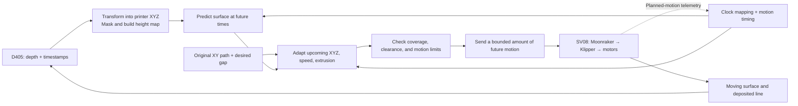

# Real-time surface prediction and SV08 controller development plan

Draft: 12 October 2026. Scope: the original Sovol SV08, RealSense D405, and this repository.

**Architecture decision, 14 October 2026:** run prediction and planning on a Pi 5
and communicate over a direct Ethernet cable with Moonraker and Klippy on the
existing SV08 H616 host, using fixed IPs on the wired interfaces. Retain the
internal MCU wiring and firmware. The example selects
`moonraker`; follow [Moonraker Ethernet setup](MOONRAKER_ETHERNET_SETUP.md).
The same-host local API adapter and [direct-host comparison](DIRECT_KLIPPER_SETUP.md)
from 13 October remain alternatives. No firmware migration or rewiring has been
performed. Runtime references to the prediction/controller host below mean the
Pi 5; the workstation remains available for training and development.

## 1. The goal and the first demonstration

Build a controller that watches a moving surface, predicts where it will be when the nozzle arrives, adjusts the upcoming printing path, and sends feasible motion to the SV08. Demonstrate that this improves both nozzle-gap control and deposited line quality.

The first version retains the scope in [docs/project/PROJECT_OUTLINE.md](../project/PROJECT_OUTLINE.md): a fixed camera, a small printing region, mostly vertical surface motion, gentle slopes, negligible sideways material motion, and single-layer lines. Keep the intended XY pattern and adapt Z, speed, and extrusion together. More layers, large folds, lateral stretching, and nozzle reorientation are later projects.

**Selected architecture: D405 → Pi 5 → wired Ethernet → existing SV08 H616 computer → printer electronics and motors.** Train on the workstation and benchmark the selected predictor on the Pi. Start with the existing firmware and measure timing before considering changes.

**Confirmed deposition setup:** the first demonstration uses the standard SV08 hotend and filament. Retain the existing extruder and heater control, and generate coordinated XYZ motion with filament extrusion. Before a hot trial, specify filament type, substrate, installed nozzle diameter, nominal gap, permitted gap error, and adhesion requirements.

The first deliverable is a measured, repeatable **cold tracking demonstration**, not a complete arbitrary-surface slicer.

## 2. What we already have, and what must be built

| Part | Present capability | Development needed |
|---|---|---|
| D405 acquisition | `surface_mapper/camera.py` captures point clouds, frame identifiers, camera timestamps, and host receipt times. | Continuous acquisition with bounded buffering, camera-to-host clock mapping, and measured frame age. |
| Height maps | `surface_mapper/heightmap.py` converts metres to millimetres and supports a rigid transform into a regular grid. | Measure the camera-to-printer transform, define the printable region, and exclude background/nozzle/beads as appropriate. |
| Prediction | `prediction/inference.py` provides streaming ConvLSTM; kinematic baselines already exist. | Expose forecasts in memory to the controller; support the actual arrival-time horizons and a controller-specific reliability gate. |
| Recording and evaluation | Saved observations, forecasts, timing, replay, and comparison reports. | Add planned/executed timing, command identities, fault events, independent gap measurements, and print-quality results. |
| Toolpath/controller | Described in the outline. | Implement trajectory adaptation, timing estimation, constrained planning, printer communication, and fault handling. |

Important implementation facts:

- `configs/d405_camera_frame.json` currently uses an identity transform. It produces **camera depth**, not printer Z. Its 2 mm cells specify horizontal sampling, not vertical accuracy.
- The current ConvLSTM predicts **one map at one fixed horizon**. Default: ten input frames and one 33.3 ms future map. Setting `horizon=3` means one map 100 ms ahead; it does not produce three future maps.
- The live commands save predictions; they do not currently send printer commands. Disk output must not become the communication channel for the controller.
- The 10 October D405 assessment found acceleration MAE 10.55 mm versus persistence 6.92 mm, with mean forecast support 23.9%. These are comparisons against later camera observations, not physical gap errors. They identify work on sensing and masking, rather than proving a fundamental camera limit. See [recording assessment](../../archive/baseline_constant_acceleration_2026-10/ca_live_20261010_143327_assessment/assessment.md), a local experiment artifact.
- The cloth experiments demonstrate forecasting research, but use a different grid, cadence, and camera geometry. Their checkpoints are not interchangeable with a calibrated D405 printing setup.

**Consequence:** develop the controller with synthetic data and simple predictors while improving real measurements. Use ConvLSTM for printing when it wins at the required horizons on relevant held-out recordings.

## 3. Hardware and where the software runs

The original SV08 has an onboard H616 computer with 1 GB RAM and 8 GB eMMC. Its published software includes Klipper and Moonraker. Think of Klipper as the motion controller software and Moonraker as the network interface used to communicate with it. The printer also has microcontrollers responsible for precisely timed motor and heater control. An additional Raspberry Pi is not required to communicate with the printer. [Sovol specifications](https://www.sovol3d.com/products/sovol-sv08-3d-printer), [official SV08 software](https://github.com/Sovol3d/SV08/tree/main/home/sovol).

| Hardware | Purpose and practical requirement | Timing |
|---|---|---|
| Existing SV08 | Retain stock electronics initially; back up its configuration and record installed versions. | Now |
| Pi 5 | Run acquisition, geometry, prediction, planning and logging; measure the complete workload with the selected model and camera cadence. | Now |
| Existing workstation | Training, development and replay; deploy the selected checkpoint and matching geometry to the Pi. | Now |
| D405 and reliable USB connection | Connect directly to the Pi. Measure actual cadence and dropped frames. | Now |
| Rigid adjustable camera mount | Attach to the stationary frame or separate rigid support, with cable strain relief. It must not follow the moving gantry. | Now |
| Stable diffuse lighting | Preserve usable surface texture without glare. Dots/texturing may help correspondence, but require tests with the actual print material. | Now |
| Wired Ethernet connection | Connect Pi and printer to the same local network; use a stable address. | Now |
| Calibration target and known height steps | Establish printer coordinates and verify depth scale, bias, and repeatability at several heights. | Now |
| Repeatable vertical-motion fixture | Begin with a rigid coupon that translates vertically; then move to a deformable membrane. Include physical travel limits and a defined stop/hold behavior. | Before moving-surface tests |
| Independent displacement measurement | An encoder or displacement sensor for the rigid fixture, plus an independent nozzle-position/gap reference. A calibrated side-view camera or suitable displacement instrument can serve this role. | Before claiming tracking accuracy |
| Shared stop/interlock arrangement | Stop both the printer and the moving fixture through a tested physical arrangement independent of the workstation/network. Account for gravity and stored mechanical energy. | Before close-clearance motion |
| Appropriate substrate and filament | Establish a static, adherent line first; fixture mounts must not obstruct homing or travel. | Before deposition |

Select reference instruments to resolve the permitted gap variation and the fastest motion being tested. A fixture encoder measures rigid translation; it does not measure local membrane deformation everywhere.

A practical first fixture is a small rigid plate on a guided vertical slide, driven by a slow actuator with position feedback and a separate USB-connected microcontroller. That controller generates repeatable motion locally, logs measured position, and implements the defined hold/stop action. Add a timestamped synchronization event visible to both measurement systems. For local-deformation experiments, replace the plate with a clamped membrane and controlled deformation mechanism. Specify stroke, load, repeatability, and stop distance before selecting the actuator; commanded motor steps alone are not the independent position reference.

The D405's stated ideal range is 7–50 cm. Choose a distance and angle inside the usable range that provide an unobstructed view of the upcoming path. Keep the camera away from hot surfaces and within its temperature limits. Its specifications do not establish the achievable gap accuracy on our substrate. [D405 manufacturer specifications](https://www.realsenseai.com/product-family/d405-series/).

The Pi 5 is the selected deployment target. Benchmark the intended camera and predictor against the same latency and accuracy tests before setting operating cadence. Putting inference on the H616 would be a separate optimization with a measured resource budget.

## 4. The complete online pipeline



Use separate workers for acquisition, prediction/planning, printer communication, and logging. Keep raw observations in a bounded time-ordered buffer. Consume the newest **complete valid history window**, rather than building an ever-growing backlog. If frames are lost, apply the model's timing rules; do not silently skip frames while pretending the original cadence was preserved.

Write logs asynchronously. Record logging drops. Do not let a slow disk, plotting window, or network dashboard stall the motion-planning loop.

The camera/planner may update at tens of hertz. Klipper and its microcontrollers perform the precise step scheduling. “Real time” here means meeting a measured prediction-to-execution deadline; a 30 FPS camera alone does not guarantee this.

## 5. Calibration and dependable height measurements

1. Establish the printer's machine coordinate frame through a documented homing and gantry-leveling procedure with the fixture clear of the probe and nozzle.
2. Observe a target with known coordinates in that frame. Estimate the rigid camera-to-printer transform; include depth-scale/bias checks and nozzle-tip calibration.
3. Verify at unused XY locations and multiple heights. Move a reference object a known positive Z distance and confirm the reported printer Z increases by the correct amount.
4. Save a new printer-frame camera configuration. Set grid bounds and Z limits in printer coordinates, not the previous camera-depth range. Version the transform and all tool offsets.
5. Begin with an approximately 40 × 40 mm region, adjusted to visibility and fixture size. Evaluate stationary noise, drift after warm-up, boundary artifacts, and known vertical motion there.
6. Mask non-substrate objects. Keep height, validity, point count, and observation age distinct. An interpolated hole or model-generated number does not become a reliable measurement just because it is finite.
7. Measure any causal filter's delay. Evaluate smooth local surface fitting where justified; do not average across background boundaries or erase real local deformation.

Require valid, sufficiently recent support over the **whole upcoming path corridor and tool clearance footprint**, not just a high percentage somewhere in the image. Occlusion beneath the nozzle is expected; use prior observations only for a validated duration and motion envelope.

For the first layer, define the forecast surface as the receiving substrate. Mask already printed beads or represent them separately. For later layers, explicitly model the printable top surface so deposited thickness is not added twice.

Use one height-compensation convention. For initial controller trials, establish the mechanical frame, then explicitly clear ordinary bed-mesh compensation and account for G-code offsets in the controller's coordinate conversion. Verify this on a stationary reference before motion. Do not combine a full predicted surface correction with another correction for the same geometry.

## 6. Predict the surface at the nozzle's arrival time

At planned path point k:

```text
forecast horizon τ[k] = nozzle arrival time[k] − camera observation time
commanded Z[k]       = predicted surface height(X[k], Y[k], arrival time[k]) + desired gap
```

The desired gap is vertical in this first prototype. Gentle slopes and a vertical nozzle are part of that approximation.

The horizon includes frame age, processing, communication, already committed motion, and travel through the newly planned segment. For example, **illustrative values only**:

| Contribution | Example |
|---|---:|
| Observation to ready trajectory | 50 ms |
| Transfer and scheduling allowance | 10 ms |
| Motion already ahead of this segment | 250 ms |
| Travel to the point within the new segment | 0–100 ms |
| Required forecasts | 310–410 ms ahead |

These numbers are not measurements of the SV08. Actual buffering may be longer. A 33 ms forecast cannot serve this example simply because inference finishes quickly.

### Clock and timing work

- Use monotonic clocks for elapsed-time calculations. Store the camera timestamp/domain, workstation receipt time, processing completion, command submission, and printer schedule time separately.
- Estimate camera-to-workstation and workstation-to-printer clock mappings, including uncertainty and drift. Receipt time contains USB/buffering delay; round-trip network measurements cannot identify all camera delay or network asymmetry.
- Distinguish the printer host's monotonic/status `eventtime` from Klipper's motion `print_time` and MCU clock domain. They are not interchangeable. Obtain a version-appropriate mapping through instrumented scheduling data; a network clock-offset estimate alone does not reveal nozzle arrival time.
- Reset and disarm after timestamp-domain changes, clock discontinuities, host restart, or printer restart. Rebuild the model history before continuing.
- Measure physical motion timing using an independent reference. Printer telemetry describes requested motion, not an encoder measurement of where the nozzle actually is.

Track median, P95, P99, and worst observed frame age, inference time, network delay, arrival-time error, and underruns. Means alone hide the failures that matter to printing.

### Forecast implementation

Start with persistence and timestamp-aware velocity/acceleration predictors, with the latter retained only when validation supports them. A fitted periodic predictor is a useful strong baseline for sinusoidal fixture tests.

After timing characterization, train models at horizons that cover the measured need. Two implementation options are:

1. A small bank of the existing fixed-horizon models. This requires limited changes, but each model adds inference cost.
2. A ConvLSTM with several future-map outputs. This is a deliberate model/training change and needs new targets, loss handling, artifacts, and evaluation.

Use only validated interpolation between supported horizons; do not extrapolate beyond the longest horizon or repeatedly feed predictions back into the current model without a separate validation protocol. Match grid geometry, coordinate transform, cadence, preprocessing, and normalization between training and deployment.

The model's history-validity masks are **not confidence estimates**. Estimate forecast error by horizon and operating condition from held-out trials. For a candidate segment, include calibration error, forecast error, timing uncertainty, and mechanical tracking error in the acceptance decision. Validate the combined gap error experimentally; adding several P95 errors is not a mathematical guarantee of a total P95 bound.

## 7. Turn predictions into feasible toolpaths

Begin with a native line/rectangle generator. It is easier to make its coordinates, timing, and extrusion explicit than to parse arbitrary slicer output. Add a limited G-code importer after the core controller works; reject unsupported commands and macros rather than guessing their effects.

For every update:

1. Identify the end of motion already submitted to Klipper. Treat that geometry as committed and preserve it. Look-ahead can still change its timing before scheduling is finalized; distinguish a submitted endpoint from a finalized motion timeline.
2. Choose the next short path section, initially using spatial subdivisions around 0.25–1 mm where geometry warrants them. This is a tuning range, not a required command frequency.
3. Estimate arrival times using acceleration, corner behavior, the existing queue, and the actual motion limits.
4. Sample forecasts at each XY position and arrival time to determine Z.
5. Smooth the join to the committed endpoint while bounding tracking error. Enforce XYZ velocity/acceleration, reachable workspace, tool clearance, extrusion, and flow limits across the entire segment.
6. Recompute timing after Z and speed change. Repeat prediction sampling/time parameterization until the timing and path agree within the measured tolerance. Reject a plan that fails to converge in its time budget.
7. Compute extrusion for the distance travelled **relative to the surface**. Submit only the earliest accepted portion; retain the remaining proposal for revision.

For a stationary surface, a useful extrusion model is:

```text
filament advance = target bead cross-sectional area × surface-relative path length
                   / filament cross-sectional area
```

Calibrate the bead model with static lines. A platform translating upward adds machine-space Z travel, but does not by itself require extra plastic. For vertical-only deformation, use the spatial surface slope along XY for surface-relative travel and remove the time-dependent vertical translation. In the more general case, integrate nozzle velocity relative to material velocity. Lateral material motion requires material tracking before this formula can preserve pattern placement.

Emit explicit coordinated XYZ/E moves, with a documented absolute/relative coordinate and extrusion mode. Convert internal mm/s to G-code feed units, and distinguish 3D motion speed from XY speed. Keep pressure advance and other deposition settings fixed and logged during comparisons.

The first transport contract should use millimetres, `G90` for absolute XYZ followed by `M83` for relative extrusion, and an explicit feed value on each generated move. During controlled setup, set and verify speed/extrusion multipliers (`M220`/`M221`), coordinate offsets, mesh state, and acceleration settings against the run configuration. Freeze these while running; changing a speed slider invalidates the predicted arrival times. Do not execute arbitrary slicer startup macros inside the streaming loop.

Do not clamp a large Z correction and continue printing as if the required gap were maintained. Slow down when that makes the trajectory feasible; otherwise follow the tested abort response. Slowing XY helps with spatial slopes but cannot eliminate rapid vertical motion of the surface itself.

## 8. SV08 communication, buffering, and control ownership

Use Moonraker over the local network for discovery, state subscriptions, and initial controlled command batches. Keep Mainsail available for inspection, while one application owns movement during a controller run. Do not stream corrections into an independently executing print file or allow competing jog commands.

Useful interface categories include printer information, object subscriptions, G-code submission, and the dedicated emergency-stop endpoint. Discover the installed version's objects/capabilities instead of assuming every upstream feature exists. [Moonraker printer API](https://moonraker.readthedocs.io/en/latest/external_api/printer/).

Klipper plans and buffers moves. G-code replies are not physical arrival confirmations, and already scheduled moves cannot be replaced through the normal G-code API. Continuously changing a Z offset is not a substitute for planning a timed XYZ trajectory. [Klipper motion planning](https://www.klipper3d.org/Kinematics.html), [Klipper code overview](https://www.klipper3d.org/Code_Overview.html).

An ordinary `G1` command has no absolute execution-time argument. Planned timestamps in our software are estimates until matched to Klipper's finalized schedule. Compare that schedule to physical motion, and use its measured uncertainty when deciding whether a forecast can control the gap. Keep Klipper's thermal, extrusion, and motion protections active.

### Integration A: characterize the existing interface

Send small, cold, prevalidated paths through a single serialized writer. Log the motion timeline and compare it with independent observations. Klipper's motion-report interfaces can help diagnose scheduling, but their updates and system load must be measured. `motion_report.live_position` is an interpolated requested position; `toolhead.position` is the last requested position. Neither supplies physical feedback. [Klipper status reference](https://www.klipper3d.org/Status_Reference.html), [Klipper API diagnostics](https://www.klipper3d.org/API_Server.html).

Find an operating window satisfying both:

```text
committed motion remaining > worst validated replenishment delay + margin
age of newest useful observation + time to end of committed/new motion
    < longest useful validated forecast horizon − timing margin
```

Keep a bounded amount of motion in both application and firmware queues. Count **time**, not just command lines. Do not treat ordinary telemetry as a complete, real-time queue-depth API. Estimate conservatively and verify against scheduled and physical motion. `M400` is useful at deliberate synchronization boundaries during characterization; using it after every batch forces draining/stopping and defeats continuous printing. [Klipper G-code reference](https://www.klipper3d.org/G-Codes.html).

### Integration B: add a local bridge only if needed

If ordinary Moonraker batches cannot provide bounded timing and continuous motion, implement a small service on the SV08 host and, only if required, a version-pinned Klipper host extension. Keep prediction on the workstation. The proposed bridge must:

- Maintain a revisable queue **before** submission to Klipper and expose the committed endpoint and estimated schedule uncertainty.
- Accept segment IDs, revisions, expiry times, configuration IDs, and bounds; reject stale, duplicate, or out-of-order segments before committing them.
- Permit revision only of unsent motion. Report acceptance, commitment, and completion as different events.
- Enforce one controller session and a local heartbeat deadline; reject further motion when the session expires.
- Run the tested local fault action and retain bounded logging without overloading Klipper.

This is new software, not a claimed stock Moonraker feature. A local bridge cannot undo committed motion or make network timing deterministic. If host integration is necessary, build and test it separately, pin the installed firmware version, back up the image/configuration, and retain a restore procedure.

On a lost reply, do not blindly resend extrusion or movement: some commands may already have been accepted. Treat state as uncertain and stop/reconcile before a new session. Automatic retry is appropriate for read-only queries, not ambiguous motion.

**Decision gate:** if no buffer duration fits both smooth execution and accurate forecasting, reduce the surface-motion envelope or improve the integration/predictor. Do not claim continuous tracking merely because individual G-code commands succeed.

## 9. Operating limits and fault behavior

Sovol's published configuration has `max_z_velocity: 20` mm/s and `max_z_accel: 500` mm/s². Inspect the actual machine; these are configuration limits, not a demonstrated tracking envelope. The gantry moves in Z, so high advertised XY speed does not establish high-frequency vertical tracking. [Official SV08 configuration](https://raw.githubusercontent.com/Sovol3d/SV08/main/home/sovol/printer_data/config/printer.cfg).

For uniform sinusoidal motion with amplitude A and frequency f:

```text
peak Z velocity     = 2π f A
peak Z acceleration = (2π f)² A
```

For example, A = 0.5 mm and f = 0.1 Hz gives approximately 0.31 mm/s and 0.20 mm/s². This is a conservative initial **fixture test proposal**, not proven printer performance. Motion across slopes adds further Z demand. A timing error of 20 ms at 5 mm/s surface speed creates approximately 0.10 mm height error even with otherwise perfect prediction.

Use these controller states:

| State | Meaning |
|---|---|
| DISCONNECTED | No motion allowed; connection and identity unverified. |
| READY | Printer connected, calibration/configuration checked; controller disarmed. |
| WARMUP | Camera and predictor building valid history. |
| ARMED | Homing/frame, fixture state, tool clearance, forecast coverage, and stop behavior verified for this run. |
| RUNNING | One controller owns the path and continuously checks deadlines and limits. |
| STOPPING | Execute the previously tested coordinated stop/clearance behavior. |
| FAULT | State is uncertain or a requirement failed; deliberate reinitialization is required. |

Triggers include stale camera input, missing corridor support, unsupported horizon, excessive prediction disagreement, missed deadlines, queue underrun/overfill, lost network, restart, limit violation, and excessive reference-measured gap error.

For a recoverable fault, cease new deposition submissions and use the validated coordinated fixture hold/stop and printer clearance sequence. Include committed motion and stopping distance in its design. A normal queued pause or retract may arrive too late; a stationary nozzle can be struck by a rising surface.

Validate the complete remaining printer and fixture trajectories, not only their final stopped positions. Holding the fixture immediately can also cause contact if the printer has already committed a downward move. Even Integration A requires an autonomous fixture/watchdog or equivalent independently validated response to workstation or network loss before close-clearance operation. Its trigger time and residual motion must fit the available clearance. A watchdog running on a frozen host cannot protect against that host's failure.

For an urgent fault, use the dedicated Moonraker `printer.emergency_stop` endpoint when communication is available, plus the independent physical stop arrangement. Klipper's direct emergency-stop interface avoids the ordinary G-code command queue. Network loss still prevents remote delivery. A shutdown does not guarantee a raised nozzle or a held fixture. [Moonraker emergency stop](https://moonraker.readthedocs.io/en/latest/external_api/printer/#emergency-stop), [Klipper emergency-stop API](https://www.klipper3d.org/API_Server.html#emergency_stop).

Demonstrate failure response with the actual fixture at large clearance before near-surface tracking. Do not automatically resume after reconnection or restart.

## 10. Software implementation work packages

Reuse `surface_mapper/` and `prediction/`. Add a `controller/` package; avoid moving working code just to match a new diagram.

| Proposed module | Responsibility | Acceptance evidence |
|---|---|---|
| `types.py`, `config.py` | Typed observations, forecasts, trajectories, printer state, units, versions, and limits. | Reject inconsistent units, geometry IDs, malformed times, and invalid limits. |
| `clock_sync.py` | Clock mappings, frame age, drift/reset detection, timing uncertainty. | Known-offset/drift replay and discontinuity tests. |
| `predictor_adapter.py` | In-memory connection to baselines/ConvLSTM with horizon and validity checks. | Replay matches existing forecasts at supported times; rejects other times. |
| `path.py`, `planner.py` | Native pattern generation, arrival-time estimates, Z adaptation, smoothing, and extrusion. | Static plane, slope, and moving-plane cases; continuity and limit checks. |
| `transport.py`, `moonraker.py` | Async connection, telemetry, serialized command ownership, explicit failure semantics. | Fake-printer delay, partial execution, lost reply, and reconnect tests. |
| `supervisor.py` | State machine, arming requirements, watchdog and stop decisions. | Fault injection transitions to a defined response without automatic motion retries. |
| `runtime.py`, `logging.py` | Bounded worker queues and synchronized run logs. | Long replay under disk/CPU delays without unbounded backlog. |
| `simulator.py`, `cli.py` | Synthetic/replay execution and command-line modes. | End-to-end demonstration without a connected printer. |
| `sv08_bridge/` if justified | Local queue and scheduling integration. | Tested against the exact installed Klipper version and measured deadlines. |

Use the existing Python/NumPy/PyTorch/RealSense stack. Add a maintained HTTP/WebSocket client for Moonraker and pin the tested dependencies in a controller requirements file. Start with a command-line interface plus a lightweight status view: surface, intended path, gap estimate, frame age, forecast horizon, buffer time, and current state. ROS is not required for this first workstation-to-printer architecture.

Minimum data shared between modules:

- **Observation:** frame ID, height/mask/count arrays, grid/transform IDs, camera time/domain, receipt time, calibrated observation time and uncertainty.
- **Forecast:** source IDs, target times, predicted maps, support/age information, model ID, and the validated error envelope applicable to this run.
- **Trajectory:** segment/revision IDs, timed XYZ/E samples, feed/acceleration constraints, validity expiry, source forecast IDs, and committed predecessor.
- **Printer state:** session/version identity, homed axes, coordinate modes/offsets, requested-motion state, temperatures, fault flags, and telemetry age.

Store configurations, hashes, original path, observations, predictions, sent commands, acknowledgements, estimated schedules, reference measurements, and failures under one run ID. The run must be replayable without a printer.

## 11. Development sequence and concrete completion criteria

The ranges below are planning estimates for one developer with hardware available; they are not promises. Recalibration, fixture fabrication, or a necessary Klipper extension may dominate the schedule.

| Stage | Work and deliverable | Gate before advancing | Effort estimate |
|---|---|---|---|
| 1. Inventory and specification | Read-only connection report; printer/config backup; choose region, fixture, material, nominal gap, and tolerances. | Machine identity and limits known; demonstrator has measurable success criteria. | 1–2 days |
| 2. Simulator and controller skeleton | Fake printer, typed interfaces, baselines, path generator, logging, state machine. Run a moving-plane simulation end to end. | Timing, motion, duplicate-command, and fault tests pass without hardware. | 3–5 days |
| 3. Calibration and static sensing | Rigid mount, transform, region mask, static noise and known-displacement report. Can run alongside stage 2. | Error and support over the path corridor fit an allocated portion of the gap-error budget. | 2–4 days |
| 4. Cold printer timing | Static elevated paths, physical timing reference, queue characterization, Z-motion envelope, stop tests. | Smooth motion and bounded arrival uncertainty; choose Integration A or B. | 3–5 days; extra if B is needed |
| 5. Dynamic cold tracking | Known vertical fixture motion; persistence/velocity/periodic baselines; compare measured gap. | Repeated tracking meets the chosen error limit and all fault injections pass. | 3–5 days |
| 6. Forecast upgrade | Record relevant data; train/evaluate horizons determined by stage 4; integrate ConvLSTM. Data work overlaps earlier stages. | Predictor meets absolute gap needs; learned model demonstrates benefit before selecting it over a simpler method. | 4–8 days |
| 7. Deposition and comparison | Static line, moving rigid coupon, simple patterns, then local deformation. | Improved print quality and gap control on repeated held-out trials. | 3–5 days |

A first controlled demonstrator is plausibly several weeks of work; do not assign a fixed completion date before the sensing and timing gates are passed.

Suggested initial experiments, subject to the measured geometry:

- Cold tracking: a roughly 40 × 40 mm region; about 5 mm initial nozzle clearance **above the entire fixture travel envelope**; 5–10 mm/s XY; fixture amplitude up to 0.5 mm and frequency about 0.1 Hz.
- Then reduce clearance in stages while monitoring an independent gap reference. Do not infer deposition capability from a successful large-gap test.
- Hot printing: first establish a static successful line with the selected filament/substrate. Derive the allowed gap range from that result, then repeat with controlled motion.

Choose a scalar permitted absolute gap error `e_allowed` before evaluating control. Allocate provisional budgets to calibration, forecast, timing, and following errors, then validate their combined result. Record both error percentiles and maximum excursion/contact events. Set a stricter collision/clearance requirement separately from average print-quality goals.

For research comparison, include static printing, moving surface with a fixed path, latest-height compensation, velocity (and periodic where relevant), acceleration if competitive, and ConvLSTM. Use identical patterns/material settings and matched motion profiles. Report any controller-driven speed reduction. Begin with at least five independent trials per condition as a pilot and increase repetitions based on variability; split by complete recording/trial, not overlapping frames.

Report prediction error **along the path by horizon**, physical gap error, deadline/queue failures, bead width and height variation, continuity, adhesion/placement where relevant, and failed trials. Choose the final predictor from validation data and preserve an untouched final test set.

## 12. What can be run now, and what the new interface should provide

These commands already exist. Run from the repository root with the current environment; use a new output directory for each experiment:

```powershell
$python = ".\.venv\Scripts\python.exe"
& $python -m unittest discover -s tests -v
& $python -m prediction baseline-live `
  --camera-config configs/d405_camera_frame.json `
  --source synthetic --frames 300 --history 5 `
  --output output/controller_baseline_smoke --record-input
```

Use an environment with PyTorch installed for the complete test suite. This smoke test checks the existing software, not printer-frame calibration or hardware control.

Once the printer address and authorized access are known, this is a **read-only discovery example**, not a command issued during preparation of this plan:

```powershell
$printerBase = "http://<SV08-address>:7125"  # Confirm actual Moonraker URL/port.
Invoke-RestMethod "$printerBase/server/info"
Invoke-RestMethod "$printerBase/printer/info"
Invoke-RestMethod "$printerBase/printer/objects/list"
```

Use the installed server's existing authentication if required; do not loosen access controls. Save the available objects and versions, then query only objects actually present.

The following is the **proposed CLI contract, not implemented commands**:

```text
python -m controller discover --config configs/controller.json
python -m controller simulate --scenario moving-plane --output <new-run>
python -m controller replay --session <recording> --path <pattern> --output <new-run>
python -m controller observe --config configs/controller.json
python -m controller dry-run --config configs/controller.json --path <pattern>
python -m controller print --config configs/controller.json --path <pattern>
```

`discover` and `observe` must not move or heat the printer. `dry-run` enables validated movement with extrusion/heating disabled. `print` requires the calibrated deposition profile and all arming conditions. All motion modes start disarmed, reject expired configurations, and expose a stop action.

## 13. The first development sprint

Implement the controller skeleton, fake-printer transport, moving-plane simulator, and read-only Moonraker discovery first. In parallel, mount/calibrate the D405 and characterize the local region. The sprint is complete when a recorded or synthetic surface drives a continuously revised virtual nozzle path, produces a timing/gap report, and handles injected dropouts and lost replies correctly.

The next sprint connects the same planner to **cold, elevated SV08 motion** and measures its execution timeline. Those measurements determine the real prediction horizon, buffer policy, and whether a local bridge is necessary. This puts controller development on a concrete path while keeping every later hardware decision tied to evidence.
